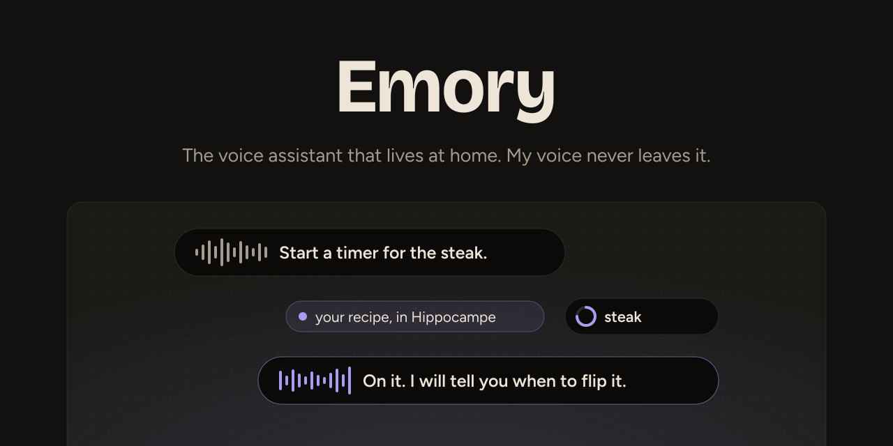
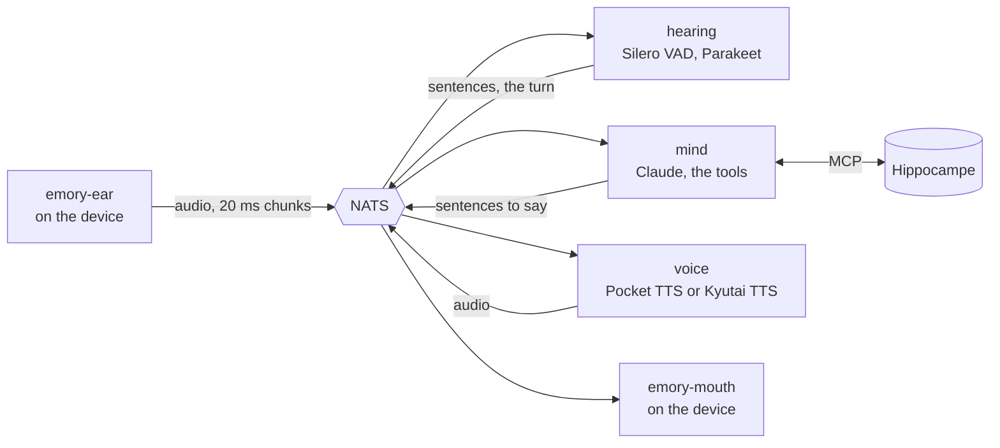

<div align="center">



[](LICENSE)

</div>

## What it is

A self-hosted voice assistant, written in Rust.

Small programs run on each device and are its ears, its mouth and, later, its hands. The mind runs
on a home server. Its long-term memory is [Hippocampe](https://github.com/KristenJestin/hippocampe),
a separate project. Emory speaks French for now. It is a prototype, and two rules shape it:

- **As little as possible leaves the house.** The sound is transcribed at home and the voice is
  made at home: no audio goes out. Only text goes to the language model (Claude), and the web
  tools ask DuckDuckGo, Wikipedia and Open-Meteo, and read the pages they found, with no account
  and no key.
- **Nothing personal is in the code.** The owner, their words, their place and their names are
  configuration and data files outside the repository; only `dev/` holds the developer's own
  settings, to try it on a PC.

## How it works



1. You press a key (a tap to open and close the turn, or hold it while you speak). `emory-ear`
   sends the microphone to the server only while the turn is open.
2. `hearing` cuts the sound into sentences and transcribes each one while you speak. `mind`
   already searches Hippocampe with each sentence.
3. At the end of the turn, `mind` asks the language model, with what the memory found and its
   tools (memory, dictionary, web, timers and reminders). Each sentence of the answer goes to
   `voice` as soon as it is written.
4. `voice` turns each sentence into sound, and `emory-mouth` plays it on the device. A new press
   while Emory speaks cuts it off.

Every program talks only to the [NATS](https://nats.io/) bus, through named subjects
(`hearing.turn`, `voice.say`…); none knows the others. On the server the bus is meant to be
locked down: TLS, one key (nkey) per device and per program, rights per subject. In development
it runs on 127.0.0.1 without either.

## The pieces

| Folder | Program | What it does |
|---|---|---|
| [`contract/`](contract) | (library) | the bus subjects and the format of every message, the only thing the programs share |
| [`ear/`](ear/README.md) | `emory-ear` | on a device: the microphone and what opens a turn (a keyboard shortcut through the GlobalShortcuts portal) |
| [`mouth/`](mouth) | `emory-mouth` | on a device: plays the voice on a speaker |
| [`hearing/`](hearing/README.md) | `hearing` | on the server: from the audio to the sentences and the turn, with Silero VAD and Parakeet (sherpa-onnx, inside the binary); int8 on the CPU, fp32 on an NVIDIA GPU |
| [`mind/`](mind/README.md) | `mind` | on the server: the conversation, the language model through ACP or an API, the memory, the tools, the sentences to say |
| [`voice/`](voice/README.md) | `voice` | on the server: has each sentence synthesised by the engine and streams the audio back to the mouth |
| [`engines/`](engines) | | the voice engines, each a small HTTP server in its container: [`pocket/`](engines/pocket/README.md) on the CPU, [`kyutai/`](engines/kyutai/README.md) on an NVIDIA GPU |
| [`dev/`](dev) | | the configurations to run it all on a development PC |
| [`specs/`](specs/README.md) | | the design notes, in French |

The hands (`emory-hands`, actions on a device through standards such as MPRIS) are designed in
[`specs/hands.md`](specs/hands.md) and not built yet.

## Build

Rust (edition 2024), on Linux. `emory-ear` and `emory-mouth` need ALSA's development files.

```sh
cargo build --release --workspace
cargo test --workspace
```

The CPU build of `hearing` downloads sherpa-onnx and ONNX Runtime while it builds. The CUDA build
is `hearing/scripts/build-cuda.sh`: see [`hearing/README.md`](hearing/README.md).

## Run it on one PC

From the root of the repository, each program in its own terminal.

```sh
docker compose -f dev/compose.yml up -d                 # NATS and Pocket TTS, on 127.0.0.1
hearing/scripts/download-models.sh                      # Silero VAD and Parakeet, in ~/.cache/emory/models
cargo run --release -p hearing -- hearing/examples/hearing.toml
cargo run --release -p voice -- dev/voice.toml
cargo run --release -p mind -- dev/mind.local.toml      # see below
cargo run --release -p mouth --bin emory-mouth          # reads ~/.config/emory/config.toml
cargo run --release -p ear                              # the same file; or `hearing-replay file.wav`
```

- **`mind` needs a Hippocampe** and a language model. Copy `dev/mind.toml` to
  `dev/mind.local.toml` (ignored by git) and put your Hippocampe address and key file there: the
  ones in `dev/` are placeholders. `dev/mind.toml` reaches Claude through
  [ACP](https://agentclientprotocol.com/) with the local Claude Code login;
  `dev/mind-api.toml` calls the Anthropic API with a key file. Every key is in
  [`mind/examples/mind.toml`](mind/examples/mind.toml).
- **The device programs** share one file, `~/.config/emory/config.toml`: start from
  [`ear/examples/config.toml`](ear/examples/config.toml). The keyboard shortcut is set up once, as
  [`ear/README.md`](ear/README.md) explains.
- **Without a microphone**, `cargo run --release -p hearing --bin hearing-replay -- file.wav` plays a
  16 kHz mono WAV file as an ear would.

## The engines and models

- Transcription: [Parakeet TDT 0.6B v3](https://huggingface.co/nvidia/parakeet-tdt-0.6b-v3)
  through [sherpa-onnx](https://github.com/k2-fsa/sherpa-onnx), and
  [Silero VAD](https://github.com/snakers4/silero-vad) to find the speech.
- Voice: [Pocket TTS](https://github.com/kyutai-labs/pocket-tts) on the CPU for development, and
  [Kyutai TTS 1.6B](https://huggingface.co/kyutai/tts-1.6b-en_fr) on an NVIDIA GPU, the voice meant
  for the server.
- The bus: [NATS](https://nats.io/).
- The mind: [Claude](https://www.anthropic.com/claude), through Claude Code and ACP or through the
  API. Other providers can be set in `api` mode.
- The memory: [Hippocampe](https://github.com/KristenJestin/hippocampe), over MCP.

## Design notes

[`specs/`](specs/README.md) holds the design notes, in French: one per organ (hearing, voice,
mind, hands), the bus contract, the web, timers and reminders, events. They keep what was decided,
when and why, with the measures behind each choice.

## Licence and credits

Free software under the [AGPL-3.0](LICENSE) (only). The third-party pieces, their licences and
which ones are shipped are listed in [`THIRD_PARTY.md`](THIRD_PARTY.md). The pictures are in
[`assets/brand`](assets/brand/README.md); their text is set in Figtree, under the SIL Open Font
License 1.1 ([`assets/brand/fonts`](assets/brand/fonts/README.md)).
